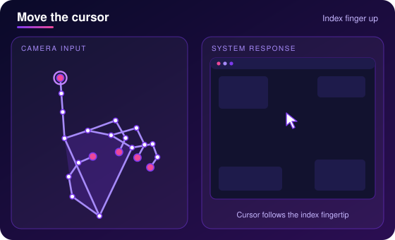
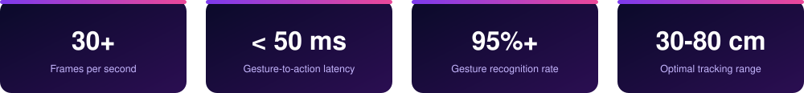

<div align="center">



<br>


**Control your computer with hand gestures, using only a webcam.**

[Overview](#overview) · [Gestures](#gesture-controls) · [How it works](#how-it-works) · [Installation](#installation) · [Applications](#applications) · [Team](#team)

</div>

---

## Overview

AI Virtual Mouse replaces the physical mouse with real-time hand tracking. A webcam captures the hand, MediaPipe extracts 21 landmarks, and the system translates finger positions into cursor movement, clicks, volume changes and a privacy mode.

**Problem.** Traditional input devices can be uncomfortable, slow, or unhygienic in some environments, especially in healthcare and other high-contact spaces.

**Solution.** A hands-free, gesture-based interface that is intuitive, adaptable and usable across several domains.

### Features

| Feature | Description |
|---|---|
| Touchless cursor control | Move the cursor with the index finger |
| Gesture clicking | Pinch two fingers together to click |
| Volume control | Adjust the system volume with the distance between thumb and pinky |
| Privacy mode | Close the fist to black out the screen instantly |
| Gesture Defender | A game controlled by hand gestures |
| Real-time processing | Smooth hand tracking at 30 FPS |

## Gesture controls

<div align="center">






</div>

| Gesture | Action | Visual feedback |
|---|---|---|
| Index finger up | Move cursor | Purple circle on the fingertip |
| Index and middle fingers pinched (< 35 px) | Left click | Green "CLICK" text |
| Thumb and pinky distance | Volume control (0-100%) | Volume percentage display |
| All fingers closed | Privacy mode | Screen blackout |

## How it works

<div align="center">



</div>

1. **OpenCV** captures each frame from the webcam.
2. **MediaPipe** detects the hand and returns 21 landmarks.
3. The gesture recognizer analyses finger positions.
4. The action mapper converts the gesture into a command.
5. **PyAutoGUI** and **Pycaw** apply the command to the system.

### Technologies

| Technology | Purpose |
|---|---|
| [Python 3.8+](https://python.org) | Core language, coordinates the whole system |
| [OpenCV](https://opencv.org) | Video capture and image processing |
| [MediaPipe](https://mediapipe.dev) | Real-time hand landmark detection (21 keypoints) |
| [NumPy](https://numpy.org) | Mathematical operations and data manipulation |
| [PyAutoGUI](https://pyautogui.readthedocs.io) | Cursor control and click simulation |
| [Pycaw](https://github.com/AndreMiras/pycaw) | Windows audio control |
| [Pygame](https://pygame.org) | Game framework for Gesture Defender |

### Technical details

- **Smoothing:** weighted average over a 4-frame buffer for stable cursor movement.
- **Detection:** 80% confidence threshold for reliable hand tracking.
- **Performance:** 30+ FPS real-time processing with less than 50 ms from gesture to action.
- **Lighting:** brightness matters. Good lighting improves the detection of finger positions and hand shape, and reduces motion blur so fast gestures stay responsive.

## Performance

<div align="center">



</div>

## Installation

**Prerequisites**

- Python 3.8 or higher
- A webcam
- Windows (required for the volume control feature)

```bash
# Clone the repository
git clone https://github.com/tass027/ai-virtual-mouse.git
cd ai-virtual-mouse

# Create a virtual environment (recommended)
python -m venv venv

# Activate it
# Windows:
venv\Scripts\activate
# macOS / Linux:
source venv/bin/activate

# Install dependencies
pip install -r requirements.txt
```

## Usage

```bash
# Virtual mouse
python src/virtual_mouse.py

# Volume control
python src/volume_control.py

# Gesture Defender game
python src/games/gesture_defender.py
```

Press `ESC` to exit any application.

## Gesture Defender

A two-player game that compares gesture control with a traditional mouse.

| Player | Control | Shoot | Deploy shield | Speed |
|---|---|---|---|---|
| Left | Hand gestures | Pinch index and middle fingers | Pinch index and ring fingers | Thumb-pinky distance |
| Right | Mouse | Left click | Right click | Not available |

**Objective:** shoot the falling threats before they reach the bottom of the screen.

## Configuration

Edit these parameters in `src/virtual_mouse.py`:

```python
self.wCam, self.hCam = 640, 480    # Camera resolution
self.smoothening = 8                # Cursor smoothness (higher = smoother)
self.frameR = 100                   # Screen edge margin
self.buffer_length = 4              # Movement buffer size
detectionCon = 0.8                  # Detection confidence (0.0 - 1.0)
trackCon = 0.8                      # Tracking confidence (0.0 - 1.0)
```

## Project structure

```
ai-virtual-mouse/
├── assets/                        # README graphics
├── src/
│   ├── virtual_mouse.py           # Main virtual mouse application
│   ├── HandTrackingModule.py      # Hand detection and tracking module
│   ├── volume_control.py          # Standalone volume control
│   └── games/
│       └── gesture_defender.py    # Gesture-controlled game
├── examples/
│   └── simple_hand_control.py     # Basic hand control example
├── requirements.txt               # Python dependencies
├── LICENSE                        # MIT License
└── README.md
```

## Applications

| Domain | Use case |
|---|---|
| Healthcare | Hands-free control for medical staff, reducing contamination risks in surgery and research |
| Sign language | Translation of hand gestures into text or speech to support the deaf and hard of hearing |
| Smart homes | Control of lights, TV or thermostat with simple gestures |
| Workplace | Hands-free navigation during presentations or 3D modeling |
| Education | Interactive learning and classroom tools for teachers and students |
| Gaming | Gesture-based control for immersive games |

## Troubleshooting

<details>
<summary><b>Camera not found</b></summary>

```python
# Test available cameras
import cv2
for i in range(3):
    cap = cv2.VideoCapture(i)
    if cap.isOpened():
        print(f"Camera {i} works")
        cap.release()
```

</details>

<details>
<summary><b>Low FPS or performance issues</b></summary>

- Close unnecessary background applications.
- Reduce the camera resolution in the code.
- Ensure good lighting conditions.
- Lower the detection confidence values.

</details>

<details>
<summary><b>Gestures not recognized</b></summary>

- Stay 30-50 cm from the camera.
- Make sure the lighting is adequate.
- Keep the entire hand visible in the frame.
- Clean the camera lens.
- Adjust the `detectionCon` and `trackCon` values.

</details>

<details>
<summary><b>Volume control not working</b></summary>

- Pycaw is Windows-only. Make sure you are running on Windows.
- Run the script with administrator privileges if needed.

</details>

## Known issues

- Volume control only works on Windows (Pycaw limitation).
- Privacy mode may flicker with very rapid hand movements.
- Performance depends heavily on lighting conditions.
- Optimal tracking requires adequate camera quality.

## Roadmap

- [ ] Right-click gesture
- [ ] Scroll gesture
- [ ] Cross-platform volume control (macOS, Linux)
- [ ] Custom gesture training
- [ ] Multi-hand support
- [ ] Gesture macro recording
- [ ] Mobile app integration
- [ ] Voice command integration

## Team

| Name |
|---|
| Tasnim Elmehrabi ([GitHub](https://github.com/tass027)) |
| Maram Bel-Houchet |
| Rihab BenYahmed |

## Contributing

1. Fork the repository.
2. Create a feature branch: `git checkout -b feature/your-feature`
3. Commit your changes: `git commit -m "Add your feature"`
4. Push the branch: `git push origin feature/your-feature`
5. Open a Pull Request.

## License

Distributed under the MIT License. See the [LICENSE](LICENSE) file.

## Acknowledgments

- The MediaPipe team for the hand tracking framework
- The OpenCV community for the computer vision tools
- The Python community

## Contact

Project: [github.com/tass027/ai-virtual-mouse](https://github.com/tass027/ai-virtual-mouse) · Issues: [GitHub Issues](https://github.com/tass027/ai-virtual-mouse/issues)
